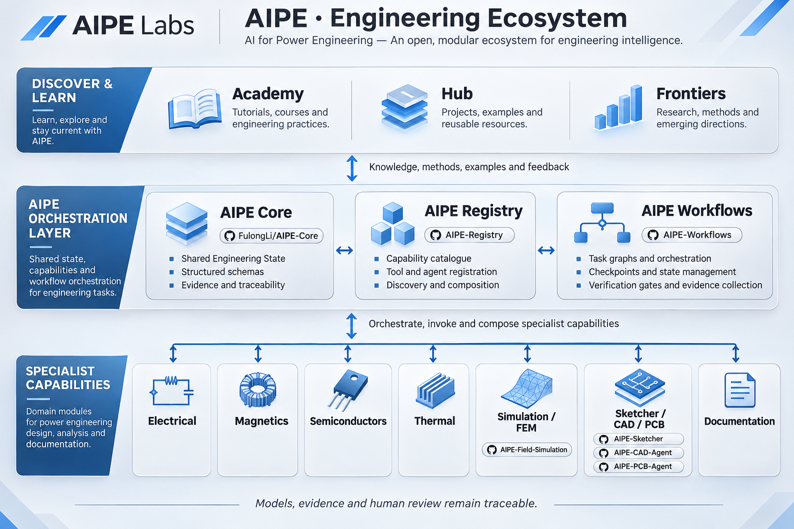
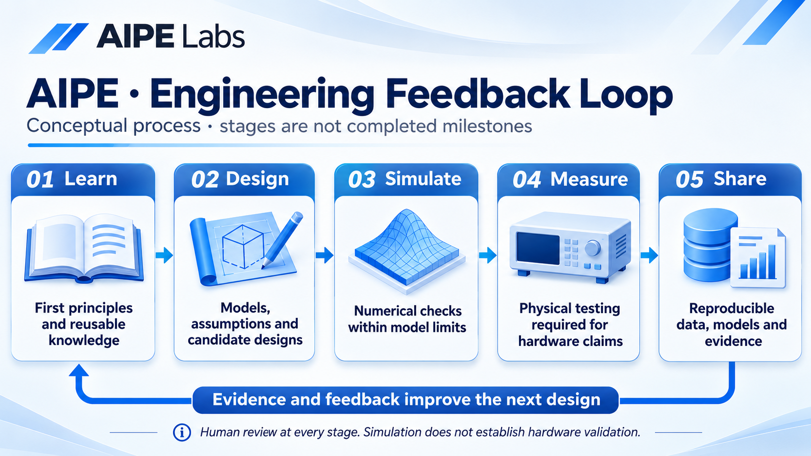

# AIPE Labs

### AI for Power Engineering

**An open engineering hub for power and energy.** 
Learn established engineering knowledge, build with reusable tools and data, and explore emerging ideas—with traceable evidence and human review.

[Website](https://aipel.co.uk/) · [Hub](https://aipel.co.uk/hub/) · [Academy](https://aipel.co.uk/academy/) · [Frontiers](https://aipel.co.uk/frontiers/) · [AIPE for coding agents](https://aipel.co.uk/plugin/) · [Machine-readable capabilities](https://aipel.co.uk/aipe.json)

---

## What is AIPE?

**AIPE (AI for Power Engineering)** is a modular engineering ecosystem connecting knowledge, datasets, analytical models, specialist software tools, AI-assisted workflows, and reproducible engineering evidence. Power electronics is its first engineering domain, with power systems and renewable energy within its broader scope.

Independent, inspectable engineering capabilities can be used on their own or composed into larger workflows.

| Learn | Build | Explore |
| :-- | :-- | :-- |
| **[AIPE Academy](https://aipel.co.uk/academy/)** — first principles, guided lessons and reproducible labs. | **[AIPE Hub](https://aipel.co.uk/hub/)** — reusable data, models, engineering tools and workflows. | **[AIPE Frontiers](https://aipel.co.uk/frontiers/)** — research directions, hypotheses and questions with explicit evidence status. |

## How the ecosystem fits together

*Conceptual ecosystem map; capability availability and evidence status are documented by each project.*

The three foundational repositories have distinct responsibilities:

- **[AIPE Core](https://github.com/FulongLi/AIPE-Core)** specifies the shared *Engineering State*, schemas, units, provenance and evidence contracts. It does **not** run solvers or agents.
- **[AIPE Registry](https://github.com/FulongLi/AIPE-Registry)** validates capability manifests and builds machine-readable and agent-readable indexes. It does **not** execute engineering tools.
- **[AIPE Workflows](https://github.com/FulongLi/AIPE-Workflows)** composes specialist capabilities into checkpointed task graphs, records results and applies verification gates. Engineering calculations remain with the specialist tools.

The architecture deliberately separates engineering facts and evidence from AI-generated explanations. A software check, an analytical result, a numerical simulation and a laboratory measurement are different levels of evidence.

## Explore the repositories

Most active AIPE development repositories currently live under **[FulongLi](https://github.com/FulongLi)**, while this **[AIPE-Labs organisation](https://github.com/AIPE-Labs)** provides a community-facing entry point. The links below lead to the relevant source repositories.

| Area | Projects and what they do |
| :-- | :-- |
| **Orchestration** | [Core](https://github.com/FulongLi/AIPE-Core) · [Registry](https://github.com/FulongLi/AIPE-Registry) · [Workflows](https://github.com/FulongLi/AIPE-Workflows) |
| **Electrical and devices** | [Electrical Design](https://github.com/FulongLi/AIPE-Electrical-Design) · [Semiconductor Database](https://github.com/FulongLi/AIPE-Semiconductor-Database) · [Converter Optimisation](https://github.com/FulongLi/AIPE-Converter-Optimisation-Agent) |
| **Magnetics and thermal** | [Magnetics Database](https://github.com/FulongLi/AIPE-Magnetics-Database) · [Thermal Design](https://github.com/FulongLi/AIPE-Thermal-Design) |
| **Circuit and field simulation** | [Simulation Skills](https://github.com/FulongLi/AIPE-Simulation-Skills) · [Field Simulation](https://github.com/FulongLi/AIPE-Field-Simulation) |
| **Engineering design agents** | [Sketcher](https://github.com/FulongLi/AIPE-Sketcher) · [CAD Agent](https://github.com/FulongLi/AIPE-CAD-Agent) · [PCB Agent](https://github.com/FulongLi/AIPE-PCB-Agent) |
| **Knowledge and publication** | [Academy](https://github.com/FulongLi/AIPE-Academy) · [IEEE Paper Agent](https://github.com/FulongLi/AIPE-IEEE-Paper-Agent) · [AIPE Doc](https://github.com/FulongLi/AIPE-Doc) |
| **Public interface** | [AIPE website](https://github.com/FulongLi/Spirit-Connect-AIPE-Labs) · [aipel.co.uk](https://aipel.co.uk/) |

Related research and resources: [MOSFET ANN modelling](https://github.com/FulongLi/AIPE-MOSFET-ANN-Modelling), [solid-state transformer studies](https://github.com/FulongLi/AIPE-Solid-State-Transformer), [inductor design example](https://github.com/FulongLi/AIPE-Magnetics-Agnet-Inductor-Design-Example), [DC microgrid test bench](https://github.com/FulongLi/DCMicrogridTestBench), [PCB Rogowski coils](https://github.com/FulongLi/PCB-Rogowski-Coil), [Transistor Database](https://github.com/FulongLi/transistordatabase), [Power Electronics Device Library](https://github.com/FulongLi/PowerElectronicsDeviceLibrary), [buck converter optimisation](https://github.com/FulongLi/BuckConverterOptimisation) and the [open-source power electronics catalogue](https://github.com/FulongLi/awesome-open-source-power-electronics).

Each project has its own requirements, maturity, supported domain and licence. Core, Registry and Workflows declare MIT; Academy uses CC BY 4.0; Thermal Design has module-specific CC BY 4.0 and MIT terms. Sketcher's draft source-available licence permits personal, non-commercial use and requires permission for commercial use. Several other projects have no declared repository licence or incomplete licence documentation. **Check each repository's licence and third-party data terms before use, redistribution or commercial adoption.**

## The engineering feedback loop

**Learn → Design → Simulate → Measure → Share → Learn.** These are process stages, not completed milestones. Record assumptions, model limits and evidence at every step; physical testing and human review are required to substantiate hardware claims.

A representative integrated benchmark is a **10 kW dual-active-bridge converter (800 V → 400 V, 100 kHz, single-phase-shift modulation)**. The [Workflows](https://github.com/FulongLi/AIPE-Workflows) repository connects electrical calculations, circuit simulation, magnetics, thermal assessment, geometry, field simulation and PCB tasks while preserving inputs, limitations and verification records.

**Current scope:** these are evolving research and engineering software prototypes. Where a workflow reports software checks or solver-backed numerical results, that does *not* establish a manufactured, measured or safety-certified converter. Device ratings, insulation, protection, EMI, thermal limits and final hardware decisions require appropriate engineering assessment and validation.

## Start here

- **Discover:** use the [AIPE Hub](https://aipel.co.uk/hub/) or read the [capability index](https://aipel.co.uk/aipe.md) to find tools, models, data and workflows.
- **Learn:** explore [AIPE Academy](https://github.com/FulongLi/AIPE-Academy), which distinguishes completed lessons and labs from planned curriculum.
- **Try a focused tool:** start with [AIPE Sketcher](https://github.com/FulongLi/AIPE-Sketcher), [AIPE Magnetics](https://github.com/FulongLi/AIPE-Magnetics-Database), or another relevant specialist repository and follow its documented installation and validation steps.
- **Explore integrated workflows:** consult the [10 kW DAB example](https://github.com/FulongLi/AIPE-Workflows/tree/main/examples/dab-10kw) and its reported verification gates.
- **Contribute:** open an issue, propose a pull request or share reproducible test cases in the relevant source repository. Follow each repository's contribution and licensing guidance.

## Principles

**Physics before presentation.** Use explicit assumptions, SI units and known model validity limits. 
**Evidence before claims.** Distinguish calculations, simulations, software checks and measurements. 
**Composable by design.** Prefer standalone specialist capabilities with versioned interfaces. 
**Human accountability.** AI assists engineering judgement; it does not replace design review or safety responsibility.

---

**AIPE Labs · Spirit Connect** 
Cardiff, United Kingdom · [aipel.co.uk](https://aipel.co.uk/) · [Contact](https://aipel.co.uk/contact/)

